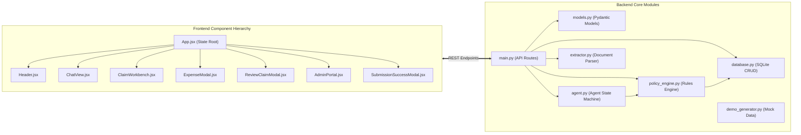
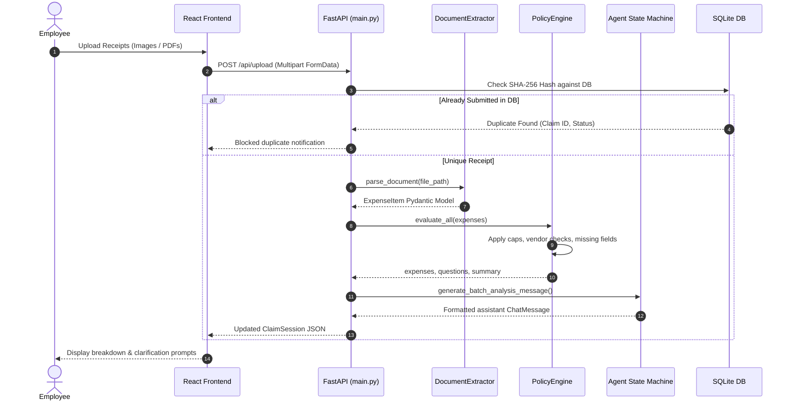
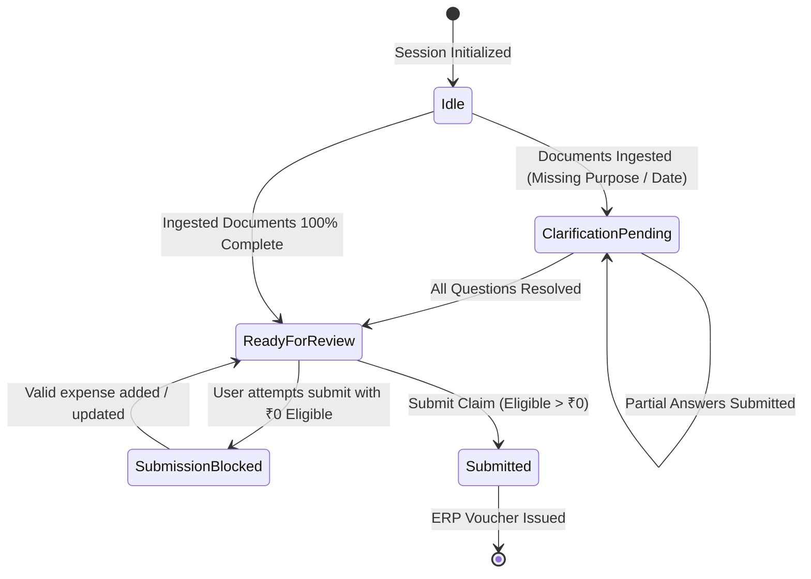
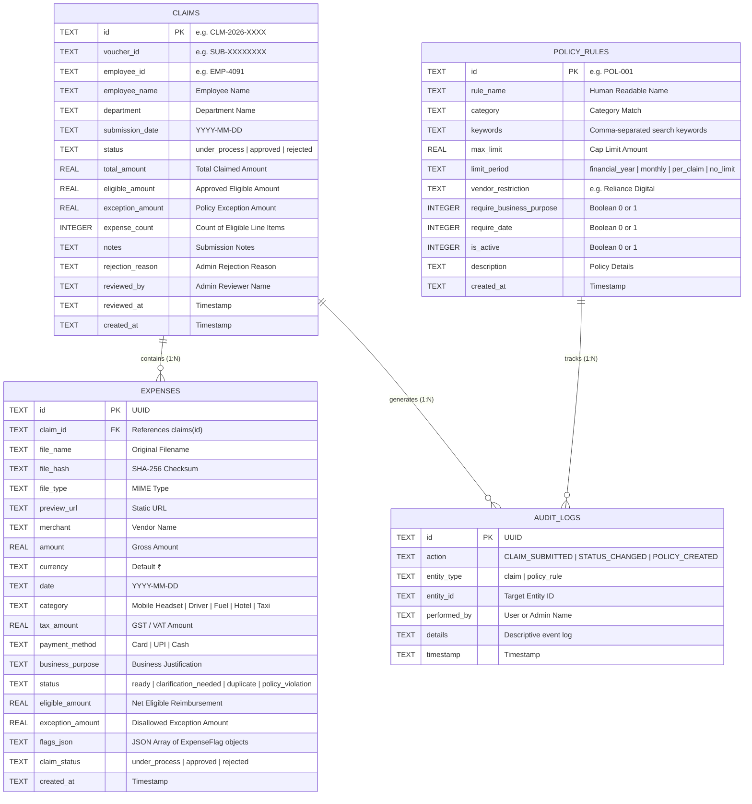
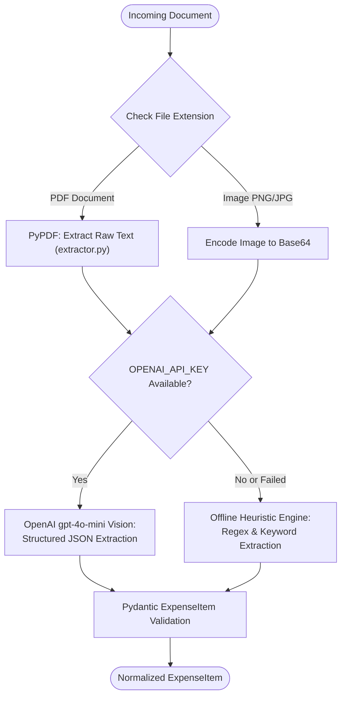
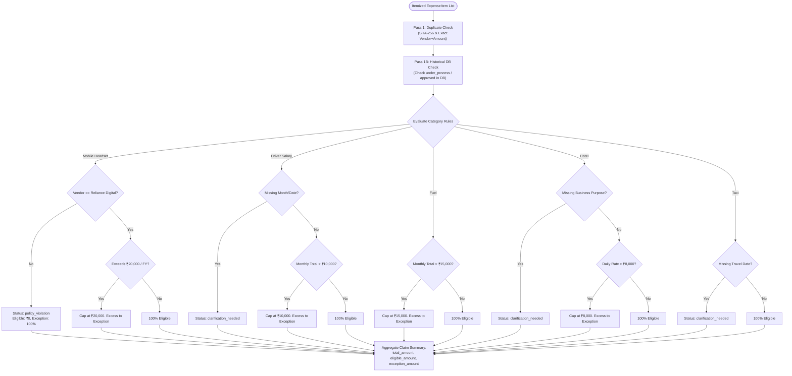
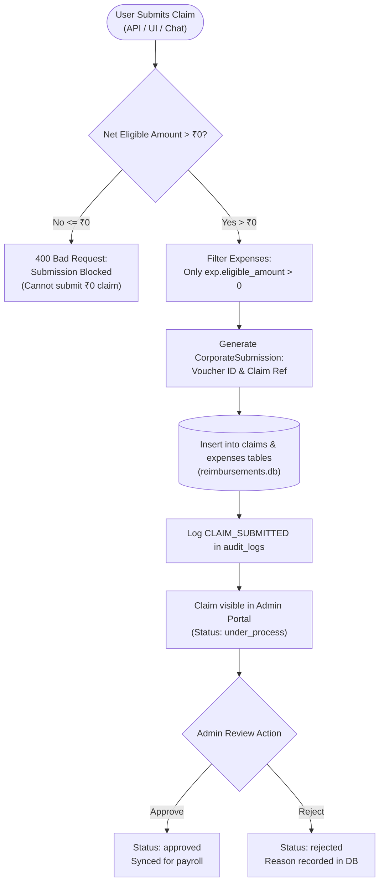
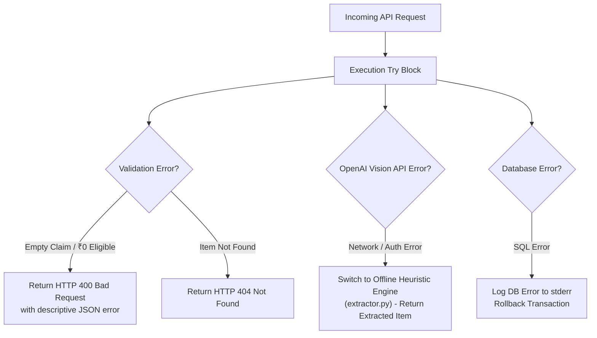
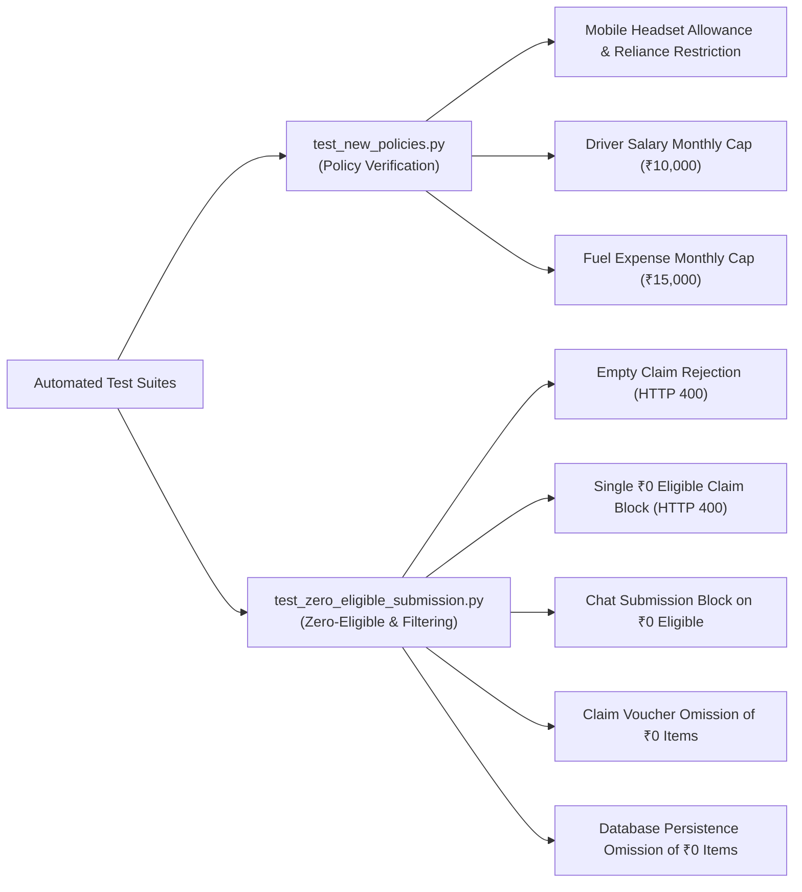
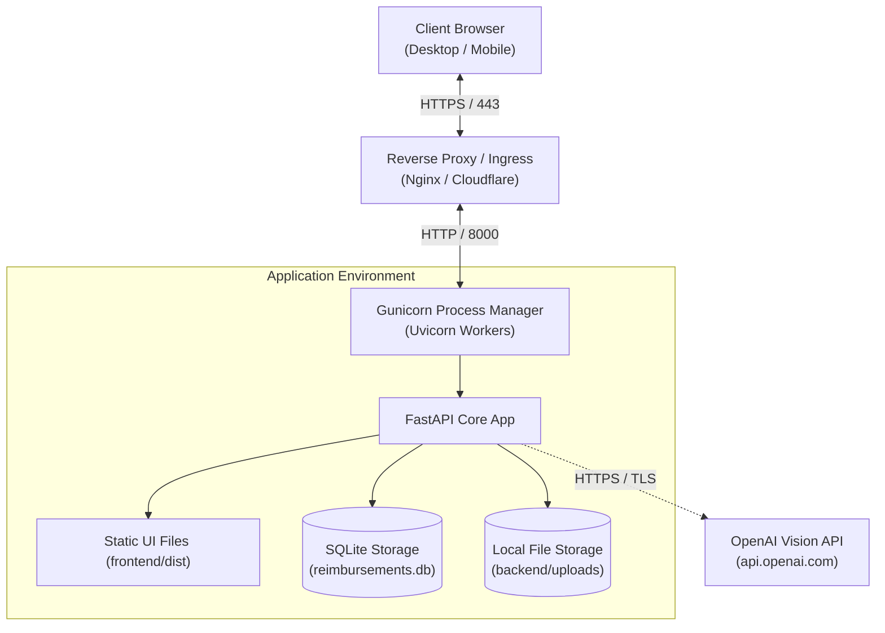

# Technical Design Document: ReimburseAI (Expense & Reimbursement Assistant)

**Document Version:** 1.0.0  
**Project Name:** ReimburseAI — Autonomous Expense & Reimbursement Assistant  
**Date:** October 2026  
**Status:** Approved / Production-Ready  
**Repository:** `c:\ExpenseReimbursementAssist`  

---

## Table of Contents
1. [Project Overview](#1-project-overview)
   - 1.1 Problem Statement
   - 1.2 Project Objectives
   - 1.3 Selected Track
   - 1.4 Scope
   - 1.5 Functional Requirements
   - 1.6 Non-Functional Requirements
   - 1.7 Technology Stack
   - 1.8 Assumptions and Constraints
2. [System Architecture](#2-system-architecture)
   - 2.1 High-Level Architecture
   - 2.2 Component Architecture
   - 2.3 End-to-End Request Flow
   - 2.4 AI Agent Architecture
   2.5 Database Architecture
   - 2.6 Receipt Processing Flow
   - 2.7 Expense Policy Validation Flow
   - 2.8 Approval/Reimbursement Flow
   - 2.9 Error Handling Flow
3. [Setup and Deployment](#3-setup-and-deployment)
   - 3.1 Prerequisites
   - 3.2 Repository Setup
   - 3.3 Python Environment
   - 3.4 Dependencies
   - 3.5 Environment Variables
   - 3.6 Database Setup
   - 3.7 Local Execution
   - 3.8 Testing
   - 3.9 Docker Setup
   - 3.10 Production Deployment
   - 3.11 Troubleshooting
4. [Code Explanation](#4-code-explanation)
   - 4.1 Complete Folder Structure
   - 4.2 Responsibility of Each Module
   4.3 Pydantic Schemas
   - 4.4 AI Conversational Agent
   - 4.5 Document Extraction Tools
   - 4.6 Extraction and Clarification Prompts
   - 4.7 Corporate Policy Engine
   - 4.8 SQLite Relational Database Models
   - 4.9 API Endpoints
   - 4.10 Authentication and Authorization
   - 4.11 Error Handling
   - 4.12 Logging and Audit Trail
5. [Design Decisions](#5-design-decisions)
6. [Assumptions](#6-assumptions)
7. [Security](#7-security)
8. [Testing Strategy](#8-testing-strategy)
9. [Deployment Architecture](#9-deployment-architecture)
10. [Limitations and Future Enhancements](#10-limitations-and-future-enhancements)
11. [Appendix](#11-appendix)

---

## 1. Project Overview

### 1.1 Problem Statement
Corporate employees spend hours collecting physical and digital bills, manually transcribing line items, deciphering company policy guidelines, resolving missing details, and cross-checking against previous submissions to avoid duplicate claims. Finance and audit teams face a heavy operational burden manually vetting messy receipts, catching duplicate claims, enforcing allowances across multiple categories (e.g., mobile headsets, driver salaries, fuel limits), and resolving employee queries.

### 1.2 Project Objectives
ReimburseAI is an AI-native autonomous corporate expense reimbursement assistant designed to convert raw receipt documents (photographs, PDFs, digital invoices) into submission-ready, audit-compliant claims through a conversational chat interface and an interactive dual-pane workbench.
Key objectives:
1. **Zero Manual Transcription:** Automatically extract merchant names, dates, amounts, taxes, currencies, payment methods, and line items.
2. **Autonomous Policy Enforcement:** Instantly evaluate company financial policies, vendor restrictions, per-claim caps, and monthly/annual limits.
3. **Conversational Clarification Loop:** Identify missing metadata (such as business purpose or travel dates) and solicit **only** the required details from the employee.
4. **Multi-Tier Deduplication Shield:** Eliminate intra-batch and cross-session duplicates by checking cryptographic file hashes and vendor/amount/date tuples against the active session and historical database records.
5. **Zero-Eligible Submission Guard:** Strictly prevent any claim with ₹0 net eligible reimbursement, and exclude ₹0 line items from being persisted or submitted.
6. **Administrative Governance & Reporting:** Provide finance administrators with an independent dashboard for claim reviews, multi-criteria filtering, policy configuration, and spend analytics.

### 1.3 Selected Track
**AI-Native Enterprise Automation / Autonomous Financial Copilot** (Receipt Document Understanding, Conversational Agents, Rules-Based Policy Governance, and Expense Lifecycle Management).

### 1.4 Scope
- **In Scope:**
  - Ingestion and parsing of image formats (`.png`, `.jpg`, `.jpeg`) and PDF documents (`.pdf`).
  - Online multimodal extraction with OpenAI Vision (`gpt-4o-mini`) and offline fallback extraction heuristics.
  - Interactive clarification loop via natural language conversational chat.
  - Enforcing corporate policy rules: Mobile Headsets (Reliance Digital vendor restriction, ₹20,000/FY cap), Driver Salary (monthly ₹10,000 cap), Fuel (monthly ₹15,000 cap), Hotel (₹8,000/night cap, mandatory purpose), Taxi (mandatory date).
  - SQLite database persistence for submitted claims, itemized receipts, custom policy rules, and immutable audit logs.
  - Dedicated Admin Portal for status transitions (`under_process`, `approved`, `rejected`), policy CRUD, and financial reports.
  - Strict blocking of ₹0 net eligible claims and exclusion of ₹0 items from payouts.
- **Out of Scope (Planned for Future Releases):**
  - Live production integration with third-party ERP platforms (SAP, Oracle NetSuite, Workday).
  - Production OAuth2 / Single Sign-On (SSO) with enterprise Identity Providers (Okta, Azure AD).
  - Direct banking automated clearing house (ACH) API integration for automated funds transfer.

### 1.5 Functional Requirements
- **FR-1 (Document Ingestion):** The system shall accept single and multi-file uploads of receipt images and PDFs via REST API and interactive drag-and-drop dropzones.
- **FR-2 (Information Extraction):** The system shall extract vendor, date, amount, currency, tax amount, payment method, category, and line items from ingested files.
- **FR-3 (Deduplication Defense):** The system shall block identical bills previously submitted in `under_process` or `approved` claims, as well as duplicate uploads within the same claim batch.
- **FR-4 (Policy Validation):** The system shall classify each expense as `ready`, `clarification_needed`, `duplicate`, or `policy_violation`, partitioning total amounts into `eligible_amount` and `exception_amount`.
- **FR-5 (Conversational Q&A):** The assistant shall generate a consolidated batch summary and prompt the user **only** for missing required details. It shall parse natural language answers provided as numbered items, multi-line text, or inline statements.
- **FR-6 (Claim Submission Protection):** The system shall strictly reject any claim where net `eligible_amount <= 0`. Individual expenses with `eligible_amount == 0` shall be omitted from final database submission.
- **FR-7 (Admin Governance):** The system shall provide an Admin Portal (`/admin`) capable of filtering claims by status, category, date, and text search, updating review statuses, configuring dynamic policy rules, and generating analytics reports.

### 1.6 Non-Functional Requirements
- **NFR-1 (Performance & Latency):** Heuristic document parsing shall complete in under 100ms per receipt. Policy evaluation across 20+ items shall complete in under 50ms.
- **NFR-2 (Resilience & Offline Autonomy):** In the absence of an external LLM API key, the system shall gracefully fall back to local heuristic extraction without interrupting workflow execution.
- **NFR-3 (Data Integrity & Consistency):** SQLite foreign keys and atomic database transactions shall maintain 100% referential integrity between claims, expenses, and audit logs.
- **NFR-4 (Usability & Responsiveness):** The web user interface shall provide responsive dual-pane views across desktop and tablet screen dimensions, with real-time reactive updates.
- **NFR-5 (Auditability):** Every status transition, claim creation, and policy configuration change shall generate an immutable entry in the `audit_logs` table.

### 1.7 Technology Stack
| Layer | Technology | Version | Purpose |
| :--- | :--- | :--- | :--- |
| **Frontend Framework** | React | 19.2.8 | Declarative component UI and state management |
| **Build Tooling** | Vite | 8.3.3 | Rapid HMR dev server and optimized production bundling |
| **Styling** | Tailwind CSS | 4.3.3 | Utility-first responsive dark-mode styling |
| **Icons & Effects** | Lucide React / Canvas Confetti | 1.52.0 / 1.9.4 | Consistent UI icons and celebration graphics |
| **Backend Framework** | FastAPI | 0.115+ | High-performance asynchronous REST API framework |
| **ASGI Server** | Uvicorn | 0.30+ | Asynchronous server gateway interface runtime |
| **Validation / Schemas** | Pydantic | 2.10+ | Data validation, settings management, and serialization |
| **PDF Extraction** | PyPDF | 5.0+ | Local text extraction from PDF tax invoices and tickets |
| **Multimodal LLM** | OpenAI API (`gpt-4o-mini`) | 1.0+ | Multimodal receipt OCR and semantic extraction |
| **Database** | SQLite3 | 3.40+ | Embedded ACID relational database persistence |
| **Language Runtime** | Python | 3.10+ / 3.12 | Primary backend runtime environment |

### 1.8 Assumptions and Constraints
- Operating environment assumes Python 3.10+ on Windows, Linux, or macOS.
- Financial currency defaults to Indian Rupees (₹ / INR).
- Single-tenant deployment model with mock employee identification (`EMP-4091`) for the user session.
- Document storage persists uploaded files to the local file system under `backend/uploads/` and `backend/sample_receipts/`.

---

## 2. System Architecture

### 2.1 High-Level Architecture

```mermaid
flowchart TD
    User(["Employee / Claimant"]) <-->|Web UI: React 19| FE["Frontend Workspace (Port 8000)"]
    Admin(["Finance Administrator"]) <-->|Admin Portal: /admin| FE

    subgraph BackendApp ["FastAPI Application (backend/main.py)"]
        Router["REST API Router"]
        Extractor["DocumentExtractor (extractor.py)"]
        Agent["ExpenseReimbursementAgent (agent.py)"]
        PolicyEng["CorporatePolicyEngine (policy_engine.py)"]
    end

    FE <-->|JSON over HTTP| Router
    Router --> Extractor
    Router --> Agent
    Agent --> PolicyEng
    PolicyEng --> DB[("SQLite Database\n(backend/reimbursements.db)")]
    Router --> DB

    subgraph External ["External Services"]
        OpenAI["OpenAI Vision API\n(gpt-4o-mini)"]
    end

    Extractor -.->|Multimodal OCR\n(Optional / Online)| OpenAI
```

**Explanation:**  
The high-level architecture separates client-side interaction (Employee Workspace and Admin Portal) from server-side business logic. The FastAPI backend orchestrates document extraction, agentic conversation, and policy validation. If an `OPENAI_API_KEY` is present, `DocumentExtractor` leverages OpenAI Vision; otherwise, it executes local heuristic parsing. All submitted claims, itemized line items, policy definitions, and audit events persist in an embedded SQLite database (`reimbursements.db`).

---

### 2.2 Component Architecture



**Explanation:**  
The frontend component hierarchy is orchestrated by `App.jsx`, which routes between employee reimbursement views and the administrative portal (`AdminPortal.jsx`). The backend is structured into modular layers: `main.py` exposes REST APIs, `models.py` provides Pydantic validation, `agent.py` drives the interactive clarification dialogue, `policy_engine.py` applies corporate rules, `extractor.py` ingests documents, and `database.py` handles relational database persistence.

---

### 2.3 End-to-End Request Flow



**Explanation:**  
When an employee uploads files, the backend calculates cryptographic SHA-256 hashes to prevent re-uploading bills currently `under_process` or `approved`. Unique files pass to `DocumentExtractor`, which extracts financial attributes. `CorporatePolicyEngine` validates policy caps, flags violations, and detects missing information. The agent crafts a concise assistant response, which the frontend renders along with actionable quick-reply buttons and workbench cards.

---

### 2.4 AI Agent Architecture



**Explanation:**  
The conversational agent operates as a deterministic, rule-guided state machine (`backend/agent.py`). When receipts have missing required fields, the session enters `clarification_pending`. When answers resolve all missing fields, the state transitions to `ready_for_review`. If the claim has ₹0 in eligible reimbursement, submission is blocked. When valid claims are submitted, the status moves to `submitted`, generating an immutable submission voucher.

---

### 2.5 Database Architecture



**Explanation:**  
The relational schema in `backend/reimbursements.db` ensures complete data normalization and integrity. Claims link to itemized line expenses via foreign keys with cascading deletions. The `expenses` table maintains SHA-256 checksums and composite indexes (`merchant`, `amount`, `date`) to accelerate duplicate detection. Dynamic policies in `policy_rules` drive runtime limit calculations, while `audit_logs` records all lifecycle modifications.

---

### 2.6 Receipt Processing Flow



**Explanation:**  
Receipt processing starts by determining the file format. PDFs are processed via `pypdf`, while images are base64-encoded. If OpenAI API access is configured and functional, the document is evaluated via `gpt-4o-mini` with structured JSON output formatting. If OpenAI credentials are absent or fail, the system falls back to the offline heuristic parser, extracting merchant patterns, dates, and amounts without service disruption.

---

### 2.7 Expense Policy Validation Flow



**Explanation:**  
The corporate policy engine (`backend/policy_engine.py`) processes expenses through deterministic checks. It first executes duplicate detection against both active session items and historical database records. Next, it validates category-specific compliance: enforcing Reliance Digital vendor restrictions for mobile headsets, service month caps for driver salaries, monthly fuel allowances, business purposes for hotel invoices, and dates for taxi receipts. Finally, it aggregates amounts into net eligible and exception totals.

---

### 2.8 Approval/Reimbursement Flow



**Explanation:**  
The reimbursement approval lifecycle begins when a user submits a claim. The system verifies that the net eligible amount exceeds ₹0. Expenses with ₹0 eligible reimbursement are excluded. The backend assigns a claim reference ID (`CLM-2026-XXXX`) and an audit reference, inserting the records into the database with initial status `under_process`. Finance administrators can subsequently inspect receipts in the Admin Portal and transition the claim to `approved` or `rejected`.

---

### 2.9 Error Handling Flow



**Explanation:**  
The error handling flow enforces defensive validation across all system entry points. Invalid operations (such as submitting an empty claim or a claim with ₹0 eligible reimbursement) return HTTP 400 status codes with descriptive error messages. If external multimodal AI calls encounter rate limits or authorization errors, the document parser falls back to offline heuristic extraction. Database operations use transaction safety to prevent partial state commits.

---

## 3. Setup and Deployment

### 3.1 Prerequisites
- **Python:** 3.10 or higher (Python 3.12 recommended).
- **Node.js:** 18.0 or higher (optional for frontend development; pre-built production bundle included in `frontend/dist`).
- **Operating System:** Windows, macOS, or Linux.
- **Git:** Version 2.30 or higher.

### 3.2 Repository Setup
Clone the project repository to your local workspace:
```bash
git clone https://github.com/organization/ExpenseReimbursementAssist.git
cd ExpenseReimbursementAssist
```

### 3.3 Python Environment
Create and activate an isolated Python virtual environment:
```bash
# Windows (PowerShell)
python -m venv .venv
.\.venv\Scripts\Activate.ps1

# Linux / macOS
python3 -m venv .venv
source .venv/bin/activate
```

### 3.4 Dependencies
Install the required Python dependencies:
```bash
pip install --upgrade pip
pip install fastapi uvicorn pydantic pypdf openai requests
```

If modifying the React frontend, install npm dependencies:
```bash
cd frontend
npm install
npm run build
cd ..
```

### 3.5 Environment Variables
Create an optional `.env` file in the project root:
```env
# Optional: Set for OpenAI Vision Multimodal Parsing
OPENAI_API_KEY=sk-proj-your-actual-api-key-here

# Optional: Host and Port configurations (Defaults: 0.0.0.0 and 8000)
HOST=0.0.0.0
PORT=8000
```
> **Note:** If `OPENAI_API_KEY` is omitted, ReimburseAI operates in offline heuristic mode with zero degradation of core claim and policy functionality.

### 3.6 Database Setup
The SQLite database initializes automatically upon server startup:
- The database file is created at `backend/reimbursements.db`.
- Database schema tables (`claims`, `expenses`, `policy_rules`, `audit_logs`) and indexes are provisioned via `init_db()` in [`backend/database.py`](file:///c:/ExpenseReimbursementAssist/backend/database.py#L15).
- Initial corporate policies and baseline historical sample claims are automatically seeded if the tables are empty.

### 3.7 Local Execution
Start the integrated server (which serves the FastAPI backend and the React single-page application):
```bash
# Using the single-command runner:
python run.py

# Or directly using uvicorn:
python -m uvicorn backend.main:app --host 0.0.0.0 --port 8000 --reload
```
Once started, open your web browser to:
- **Employee Copilot UI:** `http://localhost:8000`
- **Admin Governance Portal:** `http://localhost:8000/admin`
- **Interactive OpenAPI Documentation:** `http://localhost:8000/docs`

### 3.8 Testing
Run the automated verification test suites:
```bash
# Test 1: Corporate Policy Rules & Perks Verification
python -m backend.test_new_policies

# Test 2: Zero Eligible Submission Guard Verification
python -m backend.test_zero_eligible_submission
```

### 3.9 Docker Setup
To containerize the application for deployment:

Create a `Dockerfile` in the root directory:
```dockerfile
FROM python:3.12-slim

WORKDIR /app

# Install system dependencies
RUN apt-get update && apt-get install -y --no-install-recommends \
    build-essential \
    && rm -rf /var/lib/apt/lists/*

# Copy requirements and install
COPY requirements.txt .
RUN pip install --no-cache-dir -r requirements.txt

# Copy backend and pre-built frontend distribution
COPY backend/ ./backend/
COPY frontend/dist/ ./frontend/dist/
COPY run.py .

EXPOSE 8000

CMD ["python", "run.py"]
```

Build and run the Docker container:
```bash
docker build -t reimburse-ai:latest .
docker run -d -p 8000:8000 -e OPENAI_API_KEY="your-key" --name reimburse-app reimburse-ai:latest
```

### 3.10 Production Deployment
For production enterprise environments:
1. **Reverse Proxy:** Terminate TLS (HTTPS) using Nginx, AWS ALB, or Cloudflare in front of the application.
2. **Process Management:** Run Uvicorn behind Gunicorn with worker management:
   ```bash
   gunicorn backend.main:app -w 4 -k uvicorn.workers.UvicornWorker --bind 0.0.0.0:8000
   ```
3. **Database Migration:** For multi-instance horizontal scaling, transition from SQLite to PostgreSQL by updating database connection strings in `backend/database.py`.

### 3.11 Troubleshooting
- **Port 8000 in use:**  
  *Symptom:* `ERROR: [Errno 10048] error while attempting to bind on address ('0.0.0.0', 8000)`  
  *Remedy:* Identify and terminate the lingering process using `netstat -ano | findstr :8000` and `Stop-Process -Id <PID> -Force` (Windows) or `kill -9 $(lsof -t -i:8000)` (Linux/macOS).
- **OpenAI 401 Unauthorized:**  
  *Symptom:* `OpenAI extraction fallback notice (switched to offline heuristic): Error code: 401`  
  *Remedy:* Verify that `OPENAI_API_KEY` is valid. The system automatically switches to offline heuristic mode without failing the request.

---

## 4. Code Explanation

### 4.1 Complete Folder Structure
```
c:\ExpenseReimbursementAssist\
├── backend/
│   ├── __init__.py
│   ├── main.py                     # FastAPI REST API endpoints & static asset serving
│   ├── agent.py                    # Conversational state machine & Q&A parser
│   ├── policy_engine.py            # Corporate policy engine & duplicate checks
│   ├── extractor.py                # Multimodal receipt extraction (OpenAI + Heuristic)
│   ├── database.py                 # SQLite schema, queries, CRUD, and audit logging
│   ├── models.py                   # Pydantic validation schemas
│   ├── demo_generator.py           # Sample receipt & mock file generation
│   ├── test_new_policies.py        # Policy test suite
│   ├── test_zero_eligible_submission.py # Zero-eligible validation test suite
│   ├── reimbursements.db           # SQLite database
│   ├── sample_receipts/            # Generated realistic receipt images & PDFs
│   └── uploads/                    # User uploaded receipt files
├── frontend/
│   ├── package.json                # Frontend dependencies & scripts
│   ├── vite.config.js              # Vite bundler configuration
│   ├── dist/                       # Production pre-built assets (HTML, JS, CSS)
│   └── src/
│       ├── main.jsx                # React DOM entry point
│       ├── App.jsx                 # Top-level state and layout container
│       └── components/
│           ├── Header.jsx          # Header with demo batch triggers & admin navigation
│           ├── ChatView.jsx        # Conversational copilot & drag-drop upload zone
│           ├── ClaimWorkbench.jsx  # Real-time expense breakdown & action controls
│           ├── ExpenseModal.jsx    # Receipt inspector and manual correction modal
│           ├── ReviewClaimModal.jsx# Itemized claim audit review table
│           ├── PolicyModal.jsx     # Corporate policy rules reference dialog
│           ├── SubmissionSuccessModal.jsx # Official submission voucher & celebratory modal
│           └── AdminPortal.jsx     # Admin records filter, reporting, & policy management
├── run.py                          # Single-command startup runner
├── README.md                       # Project introduction & user guide
└── TECHNICAL_DESIGN_DOCUMENT.md    # This technical specification document
```

### 4.2 Responsibility of Each Module
- **[`backend/main.py`](file:///c:/ExpenseReimbursementAssist/backend/main.py):** Implements all REST endpoints for chat sessions, file uploads, sample batch loading, item updates/deletions, claim submissions, and admin management. Mounts static file directories for uploads and pre-built frontend assets.
- **[`backend/agent.py`](file:///c:/ExpenseReimbursementAssist/backend/agent.py):** Implements `ExpenseReimbursementAgent`, orchestrating the conversational dialogue, parsing employee clarification answers across multiple formats, and handling submission actions.
- **[`backend/policy_engine.py`](file:///c:/ExpenseReimbursementAssist/backend/policy_engine.py):** Implements `CorporatePolicyEngine`, running duplicate checks (in-session and database-level), policy allowances, vendor constraints, and financial aggregate calculations.
- **[`backend/extractor.py`](file:///c:/ExpenseReimbursementAssist/backend/extractor.py):** Implements `DocumentExtractor`, providing multimodal extraction using OpenAI Vision and resilient offline regex/keyword heuristics.
- **[`backend/database.py`](file:///c:/ExpenseReimbursementAssist/backend/database.py):** Manages SQLite tables, historical deduplication queries, claim submissions, admin filtering, reporting aggregations, policy CRUD, and audit logging.
- **[`backend/models.py`](file:///c:/ExpenseReimbursementAssist/backend/models.py):** Defines Pydantic models for type safety, validation, and serialization.
- **[`backend/demo_generator.py`](file:///c:/ExpenseReimbursementAssist/backend/demo_generator.py):** Programmatically generates realistic receipt images and PDF documents for demonstration batches.

### 4.3 Pydantic Schemas
Defined in [`backend/models.py`](file:///c:/ExpenseReimbursementAssist/backend/models.py):
- **`LineItem`:** Represents an itemized line item (`item`, `quantity`, `amount`).
- **`ExpenseFlag`:** Represents policy compliance notes or warnings (`code`, `message`, `severity`, `field`).
- **`ExpenseItem`:** Represents a parsed expense receipt (`id`, `file_name`, `file_hash`, `preview_url`, `merchant`, `amount`, `currency`, `date`, `category`, `tax_amount`, `payment_method`, `business_purpose`, `line_items`, `status`, `flags`, `eligible_amount`, `exception_amount`).
- **`ChatMessage`:** Represents a conversational dialogue turn (`id`, `role`, `content`, `timestamp`, `actions`, `summary_card`).
- **`ClarificationQuestion`:** Represents a required question posed to the employee (`expense_id`, `question_number`, `field`, `prompt`, `quick_suggestions`).
- **`ClaimSummary`:** Contains financial aggregates (`total_count`, `ready_count`, `clarification_count`, `duplicate_count`, `total_amount`, `eligible_amount`, `exception_amount`).
- **`CorporateSubmission`:** Contains submission voucher data (`submission_id`, `claim_reference`, `submitted_at`, `employee_name`, `total_amount`, `eligible_amount`, `exceptions_amount`, `status`, `audit_id`).
- **`ClaimSession`:** Top-level session state model (`session_id`, `employee_name`, `expenses`, `pending_questions`, `chat_history`, `summary`, `submission`, `status`).

### 4.4 AI Conversational Agent
Located in [`backend/agent.py`](file:///c:/ExpenseReimbursementAssist/backend/agent.py):
- **`process_user_message(session, user_text)`:** Intercepts user inputs. Identifies greetings, submission commands (`submit claim`, `file claim`), policy questions, and clarification responses.
- **`_resolve_pending_questions(session, user_input)`:** Robust natural language resolver supporting:
  - *Pattern 1:* Numbered answers (`1. Client meeting in Bangalore\n2. 24 September`).
  - *Pattern 2:* Line-by-line responses matching question count.
  - *Pattern 3:* Comma-separated or inline answers (`1. Meeting, 2. 24 Sept`).
  - *Pattern 4:* Semantic regex matching for dates (`24 September`) and business purposes (`client meeting`).
- **`submit_claim(session)`:** Finalizes claim submission. Defensively blocks submission if `summary.eligible_amount <= 0`. Filters submitted items to include only `eligible_amount > 0` and formats a confirmation message detailing approved vs excluded items.

### 4.5 Document Extraction Tools
Located in [`backend/extractor.py`](file:///c:/ExpenseReimbursementAssist/backend/extractor.py):
- **`parse_document(file_path, file_name, preview_url)`:** Primary entry point. Calculates the SHA-256 hash, determines file type, attempts OpenAI Vision extraction, and falls back to offline heuristic extraction if needed.
- **`_extract_with_openai(file_path, is_pdf)`:** Submits documents to OpenAI `gpt-4o-mini` with a structured JSON schema instruction.
- **`_extract_heuristics(file_path, file_name, preview_url)`:** Offline parsing engine using regular expressions and merchant dictionaries to extract values without third-party services.

### 4.6 Extraction and Clarification Prompts
The extraction prompt provided to OpenAI Vision in [`backend/extractor.py`](file:///c:/ExpenseReimbursementAssist/backend/extractor.py#L47):
```
Analyze this receipt/invoice. Extract the following JSON structure:
{
    "merchant": "Vendor or Merchant Name",
    "amount": float,
    "currency": "₹" or "$",
    "date": "YYYY-MM-DD" or null if missing/blurred,
    "category": "Mobile Headset" | "Driver Salary" | "Fuel" | "Hotel" | "Taxi" | "Meals" | "Transport" | "Office Supplies" | "Telecommunication" | "Other",
    "business_purpose": string or null if not stated,
    "tax_amount": float or 0,
    "payment_method": "Personal Card" | "Corporate Card" | "UPI" | "Cash",
    "line_items": [
        {"item": "Description", "quantity": 1, "amount": float}
    ]
}
Return ONLY the valid JSON object.
```

### 4.7 Corporate Policy Engine
Located in [`backend/policy_engine.py`](file:///c:/ExpenseReimbursementAssist/backend/policy_engine.py):
- **`evaluate_all(expenses)`:**
  1. *Duplicate Detection Pass 1:* Compares pairs of expenses in the current batch by SHA-256 hash or `(merchant, amount)` match.
  2. *Historical Deduplication Pass 1B:* Invokes `check_bill_duplicate_in_db` in `database.py` to identify bills previously submitted in `under_process` or `approved` claims.
  3. *Policy Evaluation Pass 2:* Applies rules for Mobile Headset (Reliance Digital vendor constraint, ₹20,000 annual cap), Driver Salary (monthly ₹10,000 cap), Fuel (monthly ₹15,000 cap), Hotel (₹8,000 nightly cap, mandatory purpose), and Taxi (mandatory travel date). Also checks dynamic rules from `policy_rules`.
  4. *Aggregates Pass 3:* Calculates `total_amount`, `eligible_amount`, `exception_amount`, and categorizes expenses.

### 4.8 SQLite Relational Database Models
Managed in [`backend/database.py`](file:///c:/ExpenseReimbursementAssist/backend/database.py):
- `init_db()` provisions tables: `claims`, `expenses`, `policy_rules`, and `audit_logs`.
- Indexes: `idx_expenses_hash` on `expenses(file_hash)`, `idx_expenses_dup_lookup` on `expenses(merchant, amount, date)`, `idx_expenses_claim_status` on `expenses(claim_status)`.

### 4.9 API Endpoints
Documented in [`backend/main.py`](file:///c:/ExpenseReimbursementAssist/backend/main.py):

| Method | Path | Description |
| :--- | :--- | :--- |
| `GET` | `/api/health` | Service health status and OpenAI availability |
| `GET` | `/api/session` | Fetches active employee claim session state |
| `POST` | `/api/session/reset` | Resets current claim session to fresh draft |
| `POST` | `/api/chat` | Sends message to conversational copilot |
| `POST` | `/api/upload` | Uploads multiple receipt files for parsing |
| `POST` | `/api/load-sample-batch`| Loads the standard 11-receipt demonstration batch |
| `POST` | `/api/load-perks-batch` | Loads the perks demonstration batch (Headset, Driver, Fuel) |
| `POST` | `/api/expenses/{id}/update` | Manually updates an expense item |
| `DELETE`| `/api/expenses/{id}` | Deletes an expense item from active claim |
| `POST` | `/api/submit-claim` | Submits claim to corporate finance (blocks if eligible ₹0) |
| `GET` | `/api/claim-voucher` | Fetches submitted claim voucher with eligible items |
| `GET` | `/api/admin/claims` | Admin: Retrieves claims with dynamic multi-field filtering |
| `GET` | `/api/admin/claims/{id}`| Admin: Fetches complete claim details with itemized receipts |
| `POST` | `/api/admin/claims/{id}/status` | Admin: Updates claim status (`under_process`, `approved`, `rejected`) |
| `GET` | `/api/admin/reports` | Admin: Aggregates spend, monthly trends, and department analytics |
| `GET` | `/api/admin/policies`| Admin: Retrieves all configured corporate policy rules |
| `POST` | `/api/admin/policies`| Admin: Creates a new corporate policy rule |
| `PUT` | `/api/admin/policies/{id}` | Admin: Updates an existing corporate policy rule |
| `POST` | `/api/admin/policies/{id}/toggle` | Admin: Toggles policy active status |
| `DELETE`| `/api/admin/policies/{id}` | Admin: Deletes a corporate policy rule |

### 4.10 Authentication and Authorization
- **Current Implementation:** Internal mock identity (`EMP-4091`, Saurabh Gupta) used for employee sessions; administrative routes are partitioned at `/api/admin/*` and the `/admin` UI route.
- **Planned / Future Enhancement:** Enterprise OAuth2 / OIDC authentication with JWT bearer validation and role-based access control (`ROLE_EMPLOYEE`, `ROLE_FINANCE_ADMIN`).

### 4.11 Error Handling
- REST endpoints use standard FastAPI `HTTPException` responses (`400 Bad Request` for invalid states, `404 Not Found` for missing resources).
- Zero-eligible submissions trigger `HTTPException(status_code=400, detail="Cannot submit a claim with ₹0 eligible reimbursement.")`.
- Document parser failures fall back to heuristic extraction without crashing requests.

### 4.12 Logging and Audit Trail
- Structured audit logging is handled through `audit_logs` table entries in `backend/database.py`.
- Events logged include: `CLAIM_SUBMITTED`, `STATUS_CHANGED_TO_APPROVED`, `STATUS_CHANGED_TO_REJECTED`, and `POLICY_CREATED`.

---

## 5. Design Decisions

### 5.1 FastAPI for Backend Framework
- **Selected:** FastAPI (Python).
- **Alternatives Considered:** Flask, Django REST Framework, Express.js (Node.js).
- **Trade-offs:** FastAPI provides native asynchronous concurrency, built-in OpenAPI schema generation, and integration with Pydantic models. It avoids Django's heavier ORM overhead while offering stronger typing than Flask.

### 5.2 Hybrid Multimodal + Offline Extraction Architecture
- **Selected:** Primary extraction using OpenAI Vision (`gpt-4o-mini`) with automatic fallback to local heuristic regex parsing.
- **Alternatives Considered:** Tesseract OCR only, AWS Textract only.
- **Trade-offs:** Proprietary cloud OCR alone introduces costs and breaks when offline. Local Tesseract requires system-level C++ binaries and often produces noisy text. The hybrid approach combines high-accuracy multimodal extraction with resilient offline fallback.

### 5.3 Embedded SQLite with Deduplication Shield
- **Selected:** SQLite with composite indexing and SHA-256 checksum matching.
- **Alternatives Considered:** PostgreSQL, Redis cache.
- **Trade-offs:** SQLite provides zero-configuration, ACID-compliant persistence without requiring external database server management. Storing binary SHA-256 hashes enables sub-millisecond deduplication checks.

### 5.4 Dual-Pane Conversational & Workbench UI
- **Selected:** Split-pane interface: Conversational Copilot on the left, live Claim Workbench on the right.
- **Alternatives Considered:** Chat-only interface, form-only interface.
- **Trade-offs:** Chat-only interfaces obscure overall claim totals, while form-only interfaces feel tedious. The dual-pane layout allows users to converse with the agent while viewing real-time financial updates on the workbench.

---

## 6. Assumptions

1. **Monetary Unit:** All financial calculations assume Indian Rupees (₹ / INR).
2. **User Context:** Single active session model representing current user `EMP-4091`.
3. **Receipt Authenticity:** Document uploads are assumed to be digital images or PDFs provided in good faith; cryptographic tamper detection beyond SHA-256 deduplication is out of scope.
4. **Offline Mode:** When an OpenAI API key is unavailable, extraction relies on heuristic pattern matching designed for standard receipts and invoices.
5. **Single-Tenant Database:** The embedded SQLite file is assumed to operate on local disk storage without multi-region concurrent write conflicts.

---

## 7. Security

### 7.1 Secrets Management
- API keys (such as `OPENAI_API_KEY`) are read exclusively from environment variables and never logged or serialized to the database or client-side bundles.

### 7.2 Receipt & Document Security
- Uploaded files receive sanitized UUID-prefixed file names (e.g., `4a2e8f_invoice.pdf`) to prevent path traversal attacks (`../`).
- Files are restricted to supported MIME types (`image/png`, `image/jpeg`, `application/pdf`).

### 7.3 PII Protection
- OCR text is parsed in-memory and discarded if not needed.
- Only extracted metadata required for expense auditing is stored.

### 7.4 Audit Logging
- Changes to claim statuses and policies create permanent records in `audit_logs` tracking timestamp, entity ID, action type, and user identity.

---

## 8. Testing Strategy

### 8.1 Automated Test Suites



### 8.2 Execution
Run test suites using the active Python virtual environment:
```bash
python -m backend.test_new_policies
python -m backend.test_zero_eligible_submission
```

---

## 9. Deployment Architecture



---

## 10. Limitations and Future Enhancements

| Area | Current Implementation | Planned Future Enhancement |
| :--- | :--- | :--- |
| **Authentication** | Client session with mock user identity (`EMP-4091`) | Enterprise SAML 2.0 / OIDC with Okta, Google Workspace, Azure AD |
| **Database** | Embedded SQLite database file (`reimbursements.db`) | Managed PostgreSQL with connection pooling (e.g. pgBouncer) |
| **ERP Integration**| Mock corporate finance ERP sync voucher (`CLM-2026-XXXX`) | Bidirectional REST/SOAP integration with SAP Concur, NetSuite, Workday |
| **OCR Breadth** | Standard receipt images and PDFs (OpenAI + Heuristics) | Local layout-aware OCR (DocTR, PaddleOCR, LayoutLM) |
| **Disbursement** | Simulated payroll cycle queue | Direct corporate bank account payout via banking APIs |

---

## 11. Appendix

### 11.1 Environment Variables
| Variable | Required | Default | Description |
| :--- | :--- | :--- | :--- |
| `OPENAI_API_KEY` | No | `None` | OpenAI API key for multimodal vision extraction |
| `HOST` | No | `0.0.0.0` | Host IP address for Uvicorn server |
| `PORT` | No | `8000` | Port for Uvicorn server |

### 11.2 Sample API Request and Response

#### Submitting a Claim:
**Request:**
`POST /api/submit-claim`
*(No request body; uses active session)*

**Response (HTTP 200 OK):**
```json
{
  "session_id": "9b128f72-74d3-41ea-bf56-821ecf4591a2",
  "employee_name": "Saurabh Gupta",
  "employee_id": "EMP-4091",
  "status": "submitted",
  "summary": {
    "total_count": 11,
    "ready_count": 10,
    "clarification_count": 0,
    "duplicate_count": 1,
    "total_amount": 38420.0,
    "eligible_amount": 36920.0,
    "exception_amount": 1500.0,
    "currency": "₹"
  },
  "submission": {
    "submission_id": "SUB-D93F102B",
    "claim_reference": "CLM-2026-7A19",
    "submitted_at": "2026-10-08 18:30:15",
    "employee_name": "Saurabh Gupta",
    "employee_id": "EMP-4091",
    "department": "Product Engineering",
    "total_amount": 38420.0,
    "eligible_amount": 36920.0,
    "exceptions_amount": 1500.0,
    "status": "Approved - Synced with Corporate Finance ERP",
    "audit_id": "AUD-F71C802A39",
    "approval_route": "Employee Submitted -> Policy Check Auto-Approved -> Queued for Direct Bank Deposit"
  }
}
```

#### Zero-Eligible Rejection:
**Request:**
`POST /api/submit-claim` (When net eligible amount is ₹0)

**Response (HTTP 400 Bad Request):**
```json
{
  "detail": "Cannot submit a claim with ₹0 eligible reimbursement. Only claims with approved/eligible expenses can be submitted."
}
```

---
*End of Technical Design Document.*
